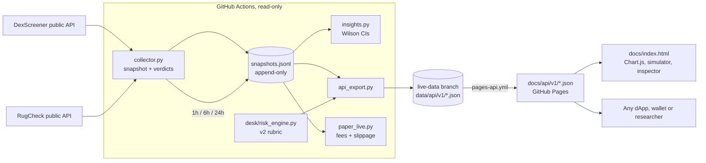

# Solana Token Risk & Forward-Test Telemetry Engine

[](https://github.com/Cyptoboy777/Pro-Desk-bot/actions/workflows/ci.yml)
[](https://github.com/Cyptoboy777/Pro-Desk-bot/actions/workflows/forward-test.yml)


An open, read-only research tool. It records real new Solana tokens, scores them with an explainable risk rubric, waits 1h / 6h / 24h, and publishes what actually happened: **which risk signals predicted rugs and which did not**, with confidence intervals, as free static JSON.

**Dashboard:** `https://cyptoboy777.github.io/Pro-Desk-bot/` (research) · `live.html` (paper desk) · `api/v1/summary.json` (API)

> **Zero-execution guarantee.** This repository never contains wallet keys, seed phrases, signing, swaps or order routing. A CI test scans every `.py`, `.js`, `.html`, `.yml` and `.json` file and fails the build if such code or an unapproved network host appears. See [SAFETY.md](SAFETY.md).

## Honest results so far

Forward test, 24h horizon, "bad" = pair vanished, or liquidity or price at least halved (see [METHODOLOGY.md](METHODOLOGY.md)). Live numbers: `api/v1/summary.json`.

| engine | passed: bad outcomes | rejected: bad outcomes | edge status |
|---|---|---|---|
| v1 rules (live) | 41/49 = 84% (CI 71-91%) | 77/202 = 38% (CI 32-45%) | `NO_EDGE` |
| v2 rubric (shadow) | 22/35 = 63% (CI 46-77%) | 96/216 = 44% (CI 38-51%) | `NO_EDGE` |

(528 tokens recorded, 251 judged, as of 2026-11-27.)

What this means: the basic static checks (authorities, LP lock, holder count, RugCheck flags) do **not** protect against 24h failure; tokens that pass them did worse than rejected ones, partly because passing needs liquidity of $20k+, which selects tokens in their most volatile phase. The v2 rubric was designed on tokens first seen before 2026-11-24 and locked; on the small post-lock sample (n=50) it also shows no separation. **We do not claim to have solved the false-pass problem.** The value of this project is the open, honest measurement that lets anyone test ideas against it. The paper desk is currently below its starting equity.

## Architecture



## Quickstart

```bash
git clone https://github.com/Cyptoboy777/Pro-Desk-bot && cd Pro-Desk-bot
pip install pytest && python -m pytest -q        # includes the zero-wallet safety guard
python3 collector.py collect && python3 collector.py score && python3 collector.py report
python3 insights.py --since 2026-11-24           # test hypotheses on new data only
python3 api_export.py --out api/v1               # build the JSON API locally
python3 -c "import json;from desk.risk_engine import assess;print(json.dumps(assess({'liq':50000,'age_min':300,'top10':12,'lp':100,'auth_ok':True,'flags':[]}),indent=1))"
```

To run it unattended on your own fork: enable Actions; `forward-test.yml` records data on the `live-data` branch and `pages-api.yml` mirrors the API into `docs/api/v1/` for GitHub Pages (Settings, Pages, deploy from `main` `/docs`). GitHub schedules are best effort: the 30-minute cron often runs every few hours, and the report only uses outcomes measured within 1.5x the horizon.

## Risk engine v2 (`desk/risk_engine.py`)

`assess(row) -> {risk_score 0-100, passed, failed_reasons, feature_vector, components, engine_version}`. Hard rules (authorities, RugCheck danger flags, LP, minimum liquidity) always fail. Then penalty points: **maturity** (age buckets), **concentration** (non-pool top-10 share, single-wallet share, insider-linked wallets), **liquidity quality** (liquidity / market cap, volume / liquidity wash pattern, last-hour buy share). Unknown data adds no points and is listed, never treated as safe. Everything is configurable through `RiskConfig`. `docs/rubric.js` is an identical JavaScript port, kept in sync by a parity test.

Naming honesty: DexScreener exposes transaction counts, not unique wallets, so "velocity" is a buy/sell *transaction* ratio, and "sniper clustering" uses RugCheck's insider-network count as a proxy.

## Public JSON API (v1)

Static files, CORS-friendly, versioned by path. Base: `https://cyptoboy777.github.io/Pro-Desk-bot/api/v1/` (fallback: `https://raw.githubusercontent.com/Cyptoboy777/Pro-Desk-bot/live-data/data/api/v1/`).

| file | contents |
|---|---|
| `summary.json` | sample size, pass vs reject survival with 95% Wilson CIs for v1 and v2-shadow at 1h/6h/24h, `edge_status` (`INSUFFICIENT_DATA`, `NO_EDGE`, `STATISTICAL_EDGE_DETECTED`), paper equity curve |
| `features.json` | signals ranked by correlation with bad outcomes, with precision, recall and intervals |
| `recent_scans.json` | latest 200 evaluations with v2 score, reasons and outcomes |
| `rubric.json` | the exact scoring configuration |
| `dataset.json` | 24h-labelled rows used by the browser simulator |

```js
const s = await (await fetch("https://cyptoboy777.github.io/Pro-Desk-bot/api/v1/summary.json")).json();
console.log(s.edge_status, s.pass_vs_reject_24h.v1.pass.survival_ci95);
```

Edge status rule: `INSUFFICIENT_DATA` until both groups have 30+ judged tokens; `STATISTICAL_EDGE_DETECTED` only if the pass group's bad-outcome interval lies entirely below the reject group's; otherwise `NO_EDGE`. It describes survival, not profit.

## Layout

`desk/` agents, risk engine, live parsers · `collector.py` forward test · `insights.py` statistics · `api_export.py` JSON API · `paper_live.py` live paper trader (0.3% fee + slippage model) · `docs/` dashboards and API · `tests/` pytest suite · `bot/` read-only Telegram risk checker · [METHODOLOGY.md](METHODOLOGY.md) · [GRANT_PROPOSAL.md](GRANT_PROPOSAL.md)

## Paper trading, alerts and the original desk

The 8-agent paper desk (scout, risk, sizer, exit, circuit breaker) and its simulated experiments are unchanged: on unseen simulated seeds the unprotected baseline lost about 3.5% a night and protections cut that to about -2.4%. No-edge markets stay unprofitable. Telegram push (`notify.py`) and the risk-check bot need your own secrets and only ever send messages.

## Hypotheses (written before testing)

H1 high volume/liquidity protective; H2 top-10 above ~18% harmful; H3 older tokens better. Test on tokens first seen after 2026-11-23 with `python3 insights.py --since 2026-11-24`. The API (`features.json`) shows which signals separate right now; confirm anything there on newer data before acting on it.

## License

MIT, see [LICENSE](LICENSE). Not financial advice. Nothing here trades.
