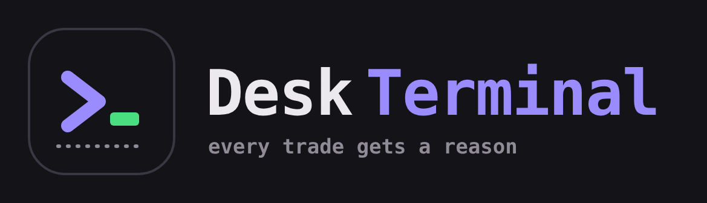
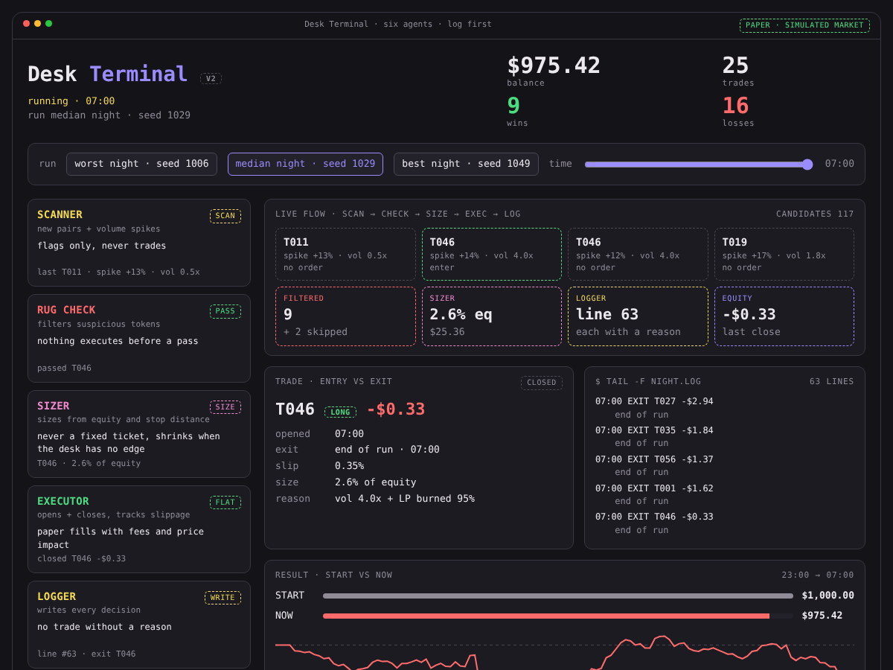
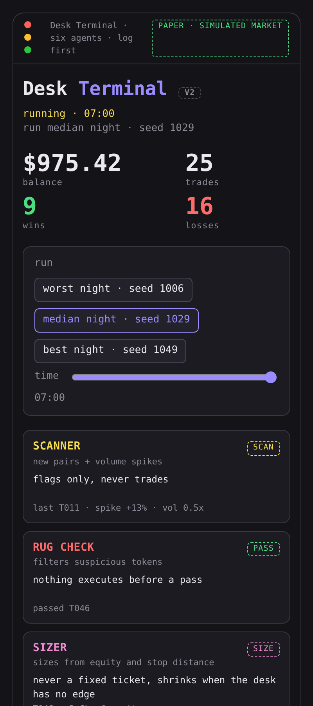

<p align="center"></p>

# Desk Terminal (Pro Desk Bot)

A paper-trading desk of six rule-based agents for new Solana tokens: **Scanner**, **Rug Check**, **Sizer**, **Executor**, **Logger**, **Equity**, with a **Head of Desk** that routes data and flags what needs a human. Every decision is written to a log with a reason.

**[Live dashboard →](https://cyptoboy777.github.io/Pro-Desk-bot/)** (static view of real paper-trading runs from the engine)

> **Paper trading only.** There is no wallet code, no private keys and no order placement. Nothing here is financial advice, and results from the built-in simulator are not evidence of real-market profit.

<p align="center"></p>
<p align="center"></p>

## What is in the box

| Path | What it does |
|---|---|
| `desk/` | Agents, sizer, protections (cooldown, stoploss guard, edge gate), paper broker, simulator |
| `experiments.py` | Tune on 100 seeds, report on 100 unseen seeds, sensitivity by rug rate and edge |
| `run_desk.py` | One simulated night, or `--seeds N` for a distribution |
| `alerts.py` | Live **read-only** alerts from DexScreener + RugCheck (run `--probe` first, see below) |
| `export_runs.py`, `dashboard_template.html` | Builds the static dashboard from real paper runs |
| `paper_live.py` | Live paper trader on real prices, state persisted between runs |
| `collector.py` | Forward test: record real new tokens, score them after 1h / 6h, compare passed vs rejected |
| `bot/telegram_bot.py` | Read-only Telegram bot: send a token address, get the Risk agent's verdict |
| `assets/` | Logo, favicon, social preview, screenshots |

## Quick start

```bash
python3 -m pip install pytest
python3 -m pytest -q tests
python3 run_desk.py --seeds 100
python3 experiments.py
python3 export_runs.py && python3 build_dashboard.py   # writes docs/index.html
```

Live alerts (read-only, optional Telegram via `TELEGRAM_BOT_TOKEN` and `TELEGRAM_CHAT_ID`):

```bash
python3 alerts.py --probe   # verify the API field names against real responses first
python3 alerts.py --once
```

The live adapter was checked against one real DexScreener and one real RugCheck response (captured 2026-11-19). It excludes liquidity-pool accounts from the top-holder share, flags Token-2022 traps (permanent delegate, transfer hook, transfer fee) and fails closed: missing safety data means the token is rejected. Note that mint-authority-disabled and LP-locked are defaults for pump.fun-style launches, so they say little there. Holder concentration, insiders and liquidity matter more.

## What the experiments found

On unseen seeds the baseline (fixed ticket, no protections) lost about 3.5% a night. Sizing alone made it worse (-5.3%). Stoploss guard, cooldown and an edge gate that shrinks size while recent closed trades are net negative together cut it to -2.4% with a worst night of -9.3%. None of this makes a no-edge market profitable. Stealth rugs look clean and pass every check, so they are bounded by size and exposure instead of detected. Profit appears only when the market has a strong edge. Details are in the dashboard and `experiments.py`.

## Safety rules the code follows

1. An LLM may comment or veto, and can never override a Rug Check rejection.
2. Missing safety data is treated as unsafe.
3. A circuit breaker halts entries at a 5% loss and flags it for a human.
4. Before any real money: weeks of live read-only alerts, then paper results you checked yourself, then a separate wallet with an amount you can afford to lose.

## Forward test (does the desk have any real edge?)

`collector.py` records real new Solana tokens with the Risk agent's verdict, then revisits them after 1h and 6h and writes price and liquidity changes. `python3 collector.py report` compares tokens that passed vs were rejected (raw price change and rug rate, before costs). To run it unattended on GitHub, copy `contrib/forward-test.workflow.yml` to `.github/workflows/forward-test.yml`; results land on the `live-data` branch (`data/report.txt`). Trust nothing before 100+ tokens per group.

## Live paper trading

`paper_live.py run` advances the desk by one tick on **real tokens and real prices** with simulated fills: it keeps a watchlist, applies the Risk agent, sizing, exits and protections, and persists state in `data/paper_state.json` (decisions in `data/paper_events.jsonl`). The Actions workflow runs it every 30 minutes; read `data/paper_report.txt` on the `live-data` branch. Limits: polling every ~30 minutes cannot honour fast stops, and DexScreener prices are not executable quotes, so treat results as indicative only.

## Telegram risk-check bot

```bash
export TELEGRAM_BOT_TOKEN=...     # create a bot with @BotFather
python3 -m bot.telegram_bot
```

Send a Solana token address (paste it, addresses are case-sensitive) or `/check <address>`. The bot reads public data only, replies with the Risk agent's reasons, fails closed when data is unavailable, and rate-limits each chat. It is a template: host it anywhere that can run a long-lived Python process.

## Work with me

I build read-only crypto analytics, risk checkers, Telegram bots and dashboards, tested and documented like this project. Message me through my GitHub profile: [@Cyptoboy777](https://github.com/Cyptoboy777).
